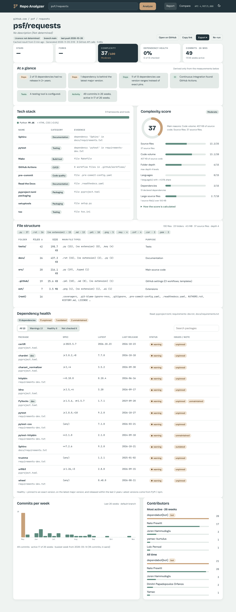
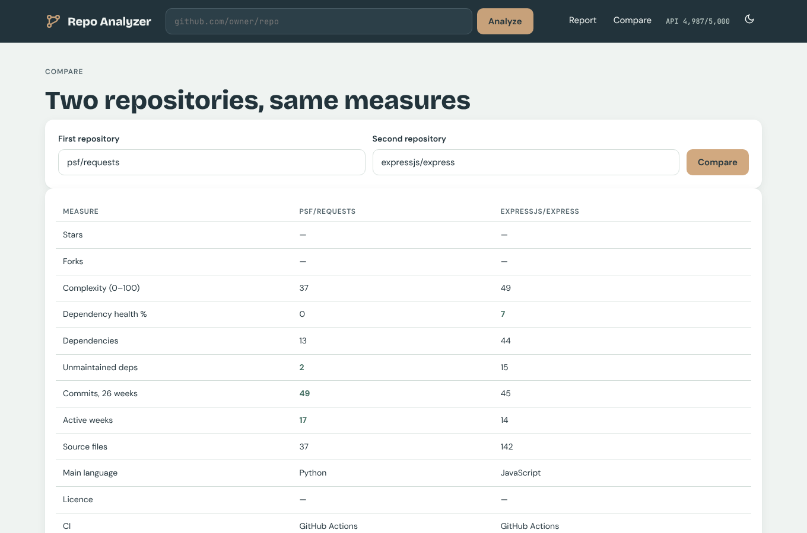
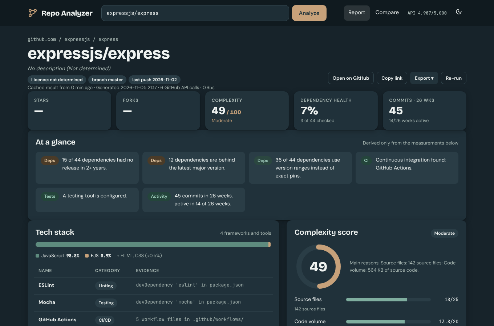
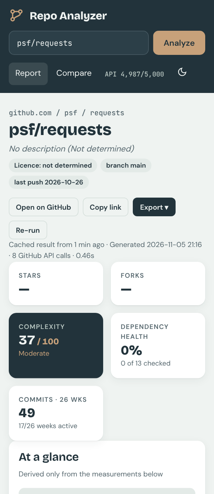

# GitHub Repository Analyzer CLI

**Hackathon Task 4: Track B (GitHub Repository Analyzer CLI)**

A command-line tool that takes any public GitHub repository URL and prints a report with five sections:

1. **Tech stack detected**: languages, frameworks and tools, each with its evidence
2. **File structure summary**: folders, file counts and types, and the purpose of each area
3. **Code complexity score**: one 0–100 score with a per-signal breakdown
4. **Dependency health**: packages from manifest files, flagged as unpinned / outdated / unmaintained
5. **Contribution activity**: a commits-per-week chart drawn in the terminal, plus the top contributors

## Web app

```bash
pip install -r requirements.txt
python web.py            # open http://localhost:8000
```

Same analysis as the CLI, in the browser: score gauge, tech stack with evidence, folder table, dependency filter,
weekly commit chart, compare two repos, export to Markdown / JSON / CSV, recent history, dark mode.



| Compare two repos | Dark mode | Phone |
|---|---|---|
|  |  |  |

## How to run (CLI)

```bash
pip install -r requirements.txt          # requests, rich
python analyze.py https://github.com/psf/requests
python analyze.py expressjs/express --save report.txt   # also save the report as text
```

Optional: set a GitHub token to raise the API limit from 60 to 5,000 requests per hour. The tool reads it **only from the environment** and never prints it.

```bash
export GITHUB_TOKEN=...        # Windows PowerShell:  $env:GITHUB_TOKEN="..."
```

One analysis uses about 5–20 GitHub API requests.

Accepted URL forms: `https://github.com/o/r`, `github.com/o/r`, `.git`, a trailing `/`, `/tree/main/...`, `git@github.com:o/r.git`, `o/r`.

## Libraries used

| Library | Why |
|---|---|
| Python 3.11+ standard library | `argparse` (CLI), `tomllib` (pyproject.toml), `concurrent.futures` (parallel registry lookups) |
| `requests` | HTTP calls to the GitHub REST API, PyPI and npm |
| `rich` | Coloured tables and panels in the terminal |

The activity chart uses our own Unicode block-character code, with no plotting library.

## Project structure

```
analyze.py                 CLI entry point: runs the stages in order and handles all errors
analyzer/url_parser.py     Stage 1  validate the URL -> owner/repo
analyzer/github_client.py  Stage 2  all GitHub API calls; 404 / rate limit / network handling
analyzer/techstack.py      Stage 3  languages + frameworks + tools, each with evidence
analyzer/structure.py      Stage 4  folder and file summary
analyzer/complexity.py     Stage 5  0-100 complexity score
analyzer/dependencies.py   Stage 6  manifest parsing + PyPI/npm health check
analyzer/activity.py       Stage 7  weekly commit chart + contributors
analyzer/report.py         Stage 8  terminal rendering
analyzer/errors.py         error types with user-friendly messages and exit codes
tests/                     unit tests (no network needed)
tools/mock_github_api.py   local GitHub API stand-in used for offline end-to-end testing
demo/                      saved reports + error-case log
```

## Definitions (how the report decides things)

### Code complexity score (0–100)
A **structural** score: how large and spread out the codebase is. It does **not** measure per-function (cyclomatic) complexity, because that would mean downloading every file.

| Signal | Weight | Maximum reached at |
|---|---|---|
| Source files | 25 | 1,000 files (log scale) |
| Code volume | 20 | 10 MB of source (log scale) |
| Folder depth | 15 | 10 levels |
| Languages (≥0.5% share) | 15 | 6 languages |
| Declared dependencies | 15 | 100 packages |
| Large source files (>100 KB) | 10 | 10% of source files |

Score = Σ weight × signal (each signal scaled to 0–1). Bands: 0–24 Low, 25–49 Moderate, 50–74 High, 75–100 Very high.
Log scales are used for size because going from 10 to 100 files changes a project much more than going from 1,000 to 1,090.

### Dependency health
Manifests read: `requirements*.txt`, `pyproject.toml` (PEP 621 + Poetry), `package.json`. A dependency is **healthy** only if all three hold:
1. **Pinned**: an exact version (`==1.2.3` / `"1.2.3"`). Ranges are flagged *unpinned*.
2. **Current**: an exact pin is on the latest major version, or a range still accepts the latest release. Otherwise *outdated*.
3. **Maintained**: the latest release is less than 2 years old. Otherwise *unmaintained*.

Latest versions and release dates come live from PyPI and npm. For npm, the tool uses the highest stable version and that version's real release date.

## How it avoids inventing data
- Every tech-stack item shows its evidence (bytes measured by GitHub, a manifest line, or a config file path).
- Unknown values print **"Not determined"** with a reason: unknown folder purpose, no manifest, no language data, missing metadata.
- Dependencies that cannot be checked are marked **"not checked"** with the reason: registry error, not on the registry, git/URL dependency, or the lookup limit.
- When data is limited, the report says so: a truncated file tree (very large repos), or more than 1,000 commits.

## Error handling
| Situation | Message | Exit code |
|---|---|---|
| Invalid URL / not GitHub / missing repo name | explains what is wrong + an example | 2 |
| Repository not found or private | "Repository 'o/r' was not found..." | 3 |
| API rate limit reached | reset time + GITHUB_TOKEN tip | 4 |
| No connection / timeout / API error | "Could not connect to GitHub..." | 5 |
| Report file cannot be saved | OS reason | 6 |
| No dependency file | report still prints; that section says "Not determined" | 0 |

## Testing
```bash
python -m unittest discover -s tests -v     # 33 tests, no network needed
```
- **Unit tests** cover URL parsing (30 inputs), every API error path with fake HTTP responses, manifest parsing, the health rules, version-range checks, the complexity bounds, and weekly bucketing.
- **End-to-end runs** on 3 real repositories: `psf/requests` (Python), `expressjs/express` (JavaScript) and `octocat/Hello-World` (no code, no manifest, inactive), plus every error case. The output is in `demo/`.
- In the build environment the GitHub API was not reachable, so the end-to-end runs used `tools/mock_github_api.py`. It serves the same API endpoints from real git clones of those repositories. Metadata that git cannot provide (stars, licence, description) is therefore shown as "Not determined", and contributor counts cover only the cloned history. PyPI and npm lookups were live. **Run the tool normally (without `GITHUB_API_URL`) for live github.com results.**

## Problems found during testing, and fixed
1. A non-URL input produced a misleading "is not github.com" message → it now says "is not a valid URL".
2. Version **ranges** were wrongly flagged *outdated* (e.g. `urllib3 >=1.26,<3` while the latest is 2.8.0) → ranges are now outdated only if they **exclude** the latest release.
3. npm's `latest` tag can lag behind (for `accepts` the tag was 1.3.8 although 2.0.0 exists) → the tool now uses the highest stable version.
4. npm's lightweight metadata only has a "modified" date (`depd`: 2025), not the real release date (2018), which made old packages look maintained → the tool now reads the real per-version release date.
5. The chart's month labels were ambiguous ("Ma" = Mar/May?) → it now uses 3-letter month names.

## Known limitations
- Dependency health covers the Python and npm ecosystems only. Other manifests (go.mod, Cargo.toml, pom.xml...) are still detected as tools, but their packages are not checked.
- The complexity score is structural, not per-function.
- The "all-time" contributor list is GitHub's own ranking (top 5).
